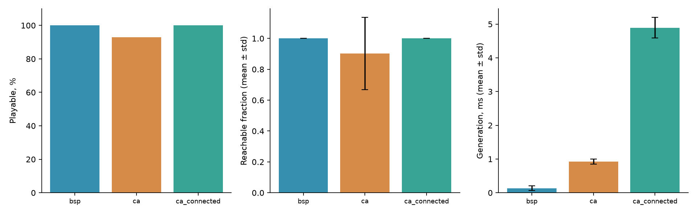

# Лабораторная работа № 7. Процедурная генерация уровней

**Студент:** Печенов В. В. · **Группа:** ИВТ-465 · **Стек:** Python + pygame · **Дата:** 17.11.2026.

**[Отчёт PDF — 6 страниц](docs/report.pdf)** · **[Отчёт Markdown](docs/report.md)** ·
**[Видео — 97 секунд](https://drive.google.com/file/d/1cDkdNA8HfKDRuWzLlP-5O3mSa5zfbJH3/view)** ·
**[Release v1.0](https://github.com/VladimirPechenov/lab07-pcg-levels/releases/tag/v1.0)**

## Выполнение требований

- [x] Два генератора: BSP и клеточный автомат B5678/S45678; локальный RNG и воспроизводимость через seed.
- [x] BFS: путь старт → финиш, доступная доля пола, кратчайший путь и число компонент.
- [x] 10 уровней каждого генератора, дополнительно 10 пещер с восстановленной связностью; **30 PNG + 30 NPY**.
- [x] Статистика по **100 seed каждого варианта**, всего 300 карт; CSV, среднее ± std, графики.
- [x] Интерактивный просмотр pygame; видеоссылка на Google Диск с доступом читателя всем по ссылке. MP4 исключён из Git.
- [x] Отчёт по всем разделам шаблона, PDF на 6 страниц, последовательные коммиты `step-1` и далее.
- [x] Тег `v1.0`, GitHub Release, проверки GitHub Actions.

Источник: [репозиторий преподавателя](https://github.com/kolesnikov-vstu-gameai/lab07-pcg-levels).
Подробная сверка: [docs/requirements.md](docs/requirements.md).
Пользователь подтвердил, что доступен только этот шаблон. Отдельные методические указания,
официальный титульный лист и ФИО преподавателя не предоставлены. Соответствие неизвестному
кафедральному макету не заявляется; отчёт следует разделам опубликованного черновика.

## Результаты

Размер 64×48, seed=0..99, 100 карт на вариант, без отбора seed. Std с `ddof=0`.
Проходимость по шаблону: доступно ≥ 60% пола и кратчайший путь ≥ 20 шагов.
Полная связность: доступно 100% пола. Финиш выбирается как самая дальняя достижимая клетка
от первого пола в порядке строк, поэтому существование пути само по себе не доказывает связность.

| Вариант | Проходимых | Полностью связных | Доля пола ± std | Доступно ± std | Генерация, мс ± std |
|---|---:|---:|---:|---:|---:|
| BSP | 100% | 100% | 0.365 ± 0.041 | 1.000 ± 0.000 | 0.136 ± 0.071 |
| CA | 93% | 25% | 0.591 ± 0.034 | 0.902 ± 0.234 | 0.926 ± 0.074 |
| CA + коридоры | 100% | 100% | 0.602 ± 0.032 | 1.000 ± 0.000 | 4.896 ± 0.303 |



BSP соединяет комнаты при обходе дерева. В исходном CA остаются отдельные области:
68 карт проходят порог проходимости, но не полностью связны. Дополнительный вариант
`ca_connected` соединяет компоненты L-образными коридорами без удаления исходного пола.
Это увеличивает долю пола и время, а прямые коридоры могут ухудшать естественный вид пещер.
Генерация и проверка выполнялись раздельно; время включает исправление для `ca_connected`,
исключает BFS-валидацию и рисунки. Один запуск на карту без прогрева, локальный замер,
а не универсальный бенчмарк. Исследован один набор параметров и размеров.

## Запуск

Проверено с Python **3.12** на Windows. Из корня репозитория:

```powershell
py -3.12 -m venv .venv
.\.venv\Scripts\python.exe -X utf8 -m pip install -r requirements.txt
.\.venv\Scripts\python.exe -m pytest
.\.venv\Scripts\python.exe -m ruff check .
.\.venv\Scripts\python.exe -m pcg.viewer
```

В pygame: **← / →** — seed, **Tab** — вариант генератора, **Esc** — выход.
В Linux/macOS используйте `python3 -m venv .venv` и `.venv/bin/python`.
Для установки точных версий выполненного окружения: `pip install -r requirements-lock.txt`.

```text
python -m pcg.render --gen all --seeds 10
python -m pcg.stats --gen all --n 100
python -m pcg.audit
```

Можно выбрать `--gen bsp`, `--gen ca` или `--gen ca_connected`.
`stats --gen all` обновляет все таблицы и summary; одиночный запуск обновляет таблицу выбранного
варианта и summary только для него. Для полного сравнения запускайте `--gen all`.
Время при повторе изменится, карты и метрики для зафиксированных версий воспроизводимы.
Зелёный маркер — старт, красный — финиш, бирюзовый — кратчайший путь,
оранжевый пол недоступен из старта. Движение по 4 соседям, координаты `(строка, столбец)`.

Параметры BSP: `min_leaf=10`, `depth=5`, комнаты от 4×4, коридор шириной 1.
Параметры CA: `fill=0.45`, `iterations=5`, стена рождается при ≥5 соседях-стенах,
сохраняется при ≥4; границы остаются стенами после каждого шага.
Значения и среда сохранены в [results/experiment.json](results/experiment.json).

## Артефакты

- [BSP — все 10 карт](results/gallery_bsp.png), [CA — все 10 карт](results/gallery_ca.png), [CA с коридорами — 10 карт](results/gallery_ca_connected.png).
- [BSP CSV](results/stats_bsp.csv), [CA CSV](results/stats_ca.csv), [CA + коридоры CSV](results/stats_ca_connected.csv), [сводка](results/summary.csv).
- `results/levels/`: исходные массивы NPY и PNG seed=0..9; CSV содержит SHA-256 всех 300 карт.
- [Видео](https://drive.google.com/file/d/1cDkdNA8HfKDRuWzLlP-5O3mSa5zfbJH3/view): 30 карт и анимация кратчайшего пути, затем результаты; без звука. Резервная MP4 — в Release.

Для пересборки отчёта и видео: `pip install -r requirements-artifacts.txt`, затем
`python tools/build_report.py` и `python tools/record_demo.py`.
Для шрифта требуется Arial в Windows либо переменная `PCG_FONT_DIR` с файлами `arial.ttf` и `arialbd.ttf`.
PDF и видео уже подготовлены: эти инструменты не нужны для запуска генераторов.

## Изменения относительно шаблона

Сохранены и доработаны алгоритмы преподавателя: исправлены незакреплённые границы CA и
ошибки пустой карты; добавлены проверки параметров, компоненты, восстановление кратчайшего пути,
детерминированное соединение пещер, маркеры и галереи, NPY и SHA-256, подробная статистика,
pygame-просмотр, 27 тестов и аудит артефактов. Unity — альтернативный стек; оставлен исходный
стартер, Unity-проект не является частью Python-решения.
