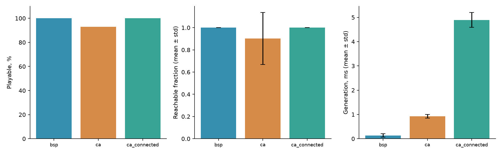

# ЛАБОРАТОРНАЯ РАБОТА № 7

Процедурная генерация уровней

Дисциплина: «Игровой искусственный интеллект»

Студент: Печенов В. В.
Группа: ИВТ-465
Стек: Python + pygame
Дата: 17.11.2026

Преподаватель: ФИО не указано в предоставленных материалах.

Источник задания: https://github.com/kolesnikov-vstu-gameai/lab07-pcg-levels

Представлены исходные коды, 30 изображений карт, статистика 300 генераций, тесты, интерактивный просмотр и видеодемонстрация. Основные алгоритмы: BSP и клеточный автомат. Дополнительно исследован CA с соединением компонент.

Примечание об оформлении. Отдельные методические указания и официальный кафедральный титульный лист пользователем не предоставлены; пользователь подтвердил, что доступен только репозиторий задания. Отчёт оформлен по разделам опубликованного черновика, объём - 6 страниц. Соответствие неизвестному официальному макету не заявляется.

# 1. Цель работы. 2. Постановка задачи

Цель: реализовать воспроизводимую процедурную генерацию двумерных уровней и оценить их качество автоматической проверкой связности, пути и площади.

Требуется: два генератора с seed; валидатор проходимости; визуализация 10 уровней; статистика по 100 уровням. Для сдачи предусмотрены последовательные коммиты, видеоссылка, тег v1.0 и GitHub Release.

Представление карты: массив int8 размера 48 строк × 64 столбца. Стена кодируется 1, пол - 0. Координаты имеют порядок (строка, столбец). Все границы закрыты стенами. Перемещение разрешено только по четырём соседям, диагональных переходов нет.

Старт S - первая клетка пола при обходе строк. Финиш F - самая дальняя от S достижимая клетка по расстоянию BFS, при равенстве используется порядок строк. Путь S-F существует по определению для непустой компоненты. Поэтому одного существования пути недостаточно для оценки качества: дополнительно измеряются доступная доля пола и компоненты.

Критерий playable сохранён из шаблона: доступно не менее 60% клеток пола, длина пути не меньше 20 шагов. Полная связность - отдельный более строгий показатель: все клетки пола доступны от S. Эти два показателя нельзя смешивать.

Протокол: для каждого варианта генерируются ровно seed=0..99 без отбраковки или повторного выбора seed. На визуализациях показаны seed=0..9 у всех вариантов. Среднее и стандартное отклонение вычисляются по 100 картам с ddof=0. Измерение времени охватывает только генерацию, включая восстановление связности для ca_connected.

# 3. Описание реализации

BSP. Прямоугольник рекурсивно делится максимум на 5 уровнях. Минимальный размер листа - 10 клеток. При вытянутом листе выбирается деление вдоль большей стороны; при разнице сторон меньше 4 направление выбирается локальным random.Random(seed). Точка разреза случайна и не создаёт дочерние области меньше min_leaf.

В листьях вырезаются прямоугольные комнаты со сторонами от 4 клеток до размера листа минус 2; от края листа остаётся хотя бы одна клетка стены. После обработки дочерних поддеревьев их представительные центры соединяются L-образным коридором шириной 1. По индукции все комнаты оказываются соединены. Глубина задаёт максимум делений, а ограничения размеров могут остановить деление раньше.

Клеточный автомат. Локальный numpy.default_rng(seed) создаёт шум с долей стен 0.45. Выполняются 5 синхронных итераций: клетка пола становится стеной при ≥5 стенах среди 8 соседей, стена сохраняется при ≥4. Обозначение B5/S4 в задании понимается как пороговое правило B5678/S45678. Внешняя область и границы всегда считаются стеной. В исходном коде границы могли измениться при сглаживании; добавлено их закрепление.

Дополнительный вариант CA-connected. Поиск компонент выполняется BFS в порядке строк. Первая клетка наибольшей компоненты служит опорной; к первой клетке каждой компоненты вырезается горизонтальный, затем вертикальный коридор. Имеющийся пол сохраняется. При полностью пустой пещере явно создаётся внутренняя прямоугольная область; для seed=0..99 эта ветка не потребовалась.

Валидатор. BFS за O(W·H) строит расстояния; доля достижимого пола равна reached/floor_cells. Кратчайший путь восстанавливается по убывающим расстояниям. Пустая карта получает reach_ratio=0, finish=None, path_len=-1. Проверяются бинарность карты и параметры генераторов. Поиск компонент также имеет линейную сложность.

Архитектура: bsp.py / cellular.py → repair.py (опционально) → validator.py → stats.py, render.py и viewer.py. Генераторы не меняют глобальное состояние RNG. SHA-256 каждой карты включён в CSV для проверки воспроизводимости.

# 4. Демонстрация

В results/levels сохранены 10 PNG и 10 массивов NPY на каждый вариант: BSP, CA и CA-connected, всего 30 карт. Галереи gallery_*.png показывают все seed без отбора. На рисунках зелёный цвет означает старт, красный - финиш, бирюзовый - кратчайший путь, оранжевый - недоступный от старта пол. Ниже seed=7 для двух основных генераторов.

Интерактивный просмотр: python -m pcg.viewer. Стрелки меняют seed, Tab переключает вариант, Esc закрывает окно. На экране видны доля доступного пола и длина пути.

Видео длительностью 97 секунд показывает по 10 фактически сгенерированных карт каждого варианта с анимацией обхода кратчайшего пути, затем таблицу измеренных результатов. Это программная демонстрация карт, без голосового сопровождения. Ссылка публикуется в README, MP4 исключён из истории Git.

Видео: https://drive.google.com/file/d/1cDkdNA8HfKDRuWzLlP-5O3mSa5zfbJH3/view

Запуск воспроизведения: python -m pcg.render --gen all --seeds 10; python -m pcg.stats --gen all --n 100. Команды выполняются после установки requirements.txt из корня репозитория. Параметры и среда записаны в results/experiment.json.

# 5. Метрики и результаты

Каждая строка ниже - 100 уровней размером 64×48; seed=0..99. Все численные значения получены запуском stats.py на данном компьютере.

| Вариант | Проходимых | Полностью связных | Доля пола ± σ | Доступно ± σ | Время, мс ± σ |
|---|---:|---:|---:|---:|---:|
| bsp | 100% | 100% | 0.365 ± 0.041 | 1.000 ± 0.000 | 0.136 ± 0.071 |
| ca | 93% | 25% | 0.591 ± 0.034 | 0.902 ± 0.234 | 0.926 ± 0.074 |
| ca_connected | 100% | 100% | 0.602 ± 0.032 | 1.000 ± 0.000 | 4.896 ± 0.303 |

В исходном CA критерию playable соответствуют 93 карты, но полностью связны только 25. Следовательно, 68 карт проходят пороговую проверку, сохраняя недоступные области. Соединение компонент повышает обе доли до 100% без удаления исходного пола.

Средняя длина кратчайшего пути: BSP 101.21 ± 9.95, CA 85.26 ± 22.74, CA-connected 96.51 ± 10.27 шагов. Среднее число компонент: 1.00, 2.49 и 1.00 соответственно. У исходного CA старт иногда находится в малой области, что объясняет падение доли доступного пола.

Цена исправления CA - дополнительные коридоры и время BFS. Простые L-коридоры могут выглядеть менее естественно и не минимальны по длине. Время - один запуск на карту без прогрева, измерено perf_counter_ns; это локальная характеристика, а не универсальное сравнение производительности. Валидация и отрисовка в время не входят.

# 6. Выводы. 7. Список литературы

Реализованы два детерминированных генератора и дополнительная обработка пещер. BSP создаёт комнаты с явной структурой и гарантирует связность соединением поддеревьев. CA формирует более сглаженные области, но сам по себе не гарантирует единую компоненту. На исследованных 100 seed соединение компонент устранило эту проблему.

Важный результат: пороговая проходимость 93% не равна полной связности 25%. Выбор финиша из достижимой компоненты не доказывает доступность всего уровня. Поэтому в отчёте приведены оба показателя, исходные карты и таблицы отдельных seed.

Ограничения: исследован один размер и один набор параметров, 100 последовательных seed. Не измерялись субъективный интерес, сложность боёв, размещение объектов и баланс. Нельзя переносить полученные доли на другие настройки. Полная связность у CA-connected обеспечивается конструкцией, но минимальная длина пути остаётся отдельным условием, проверяемым валидатором.

Дальнейшие улучшения: выбирать ближайшие пары компонент, соединять их минимальным остовным деревом, исследовать вероятность стен и число итераций, вводить ограничения на ширину проходов и размещение игровых объектов.

Проверка: 27 тестов покрывают детерминизм, независимость RNG, границы карт, точное правило одного шага CA, связность 100 seed, вручную вычисленный BFS, пустую карту, пороговые условия, сохранение пола при исправлении и некорректные параметры. Линтер ruff проверяет весь Python-код; GitHub Actions запускает линтер и тесты.

1. Репозиторий задания и черновик отчёта: https://github.com/kolesnikov-vstu-gameai/lab07-pcg-levels (дата обращения: 17.11.2026).

2. Исходная реализация преподавателя: src/pcg/bsp.py, cellular.py, validator.py в том же репозитории. Алгоритмы расширены и исправлены в данной работе.

Приложение. Репозиторий решения: https://github.com/VladimirPechenov/lab07-pcg-levels

Артефакты: docs/report.pdf и report.md; results/stats_*.csv, summary.csv, experiment.json; results/levels/*.png и *.npy; results/gallery_*.png; видео по ссылке README; Release v1.0.
